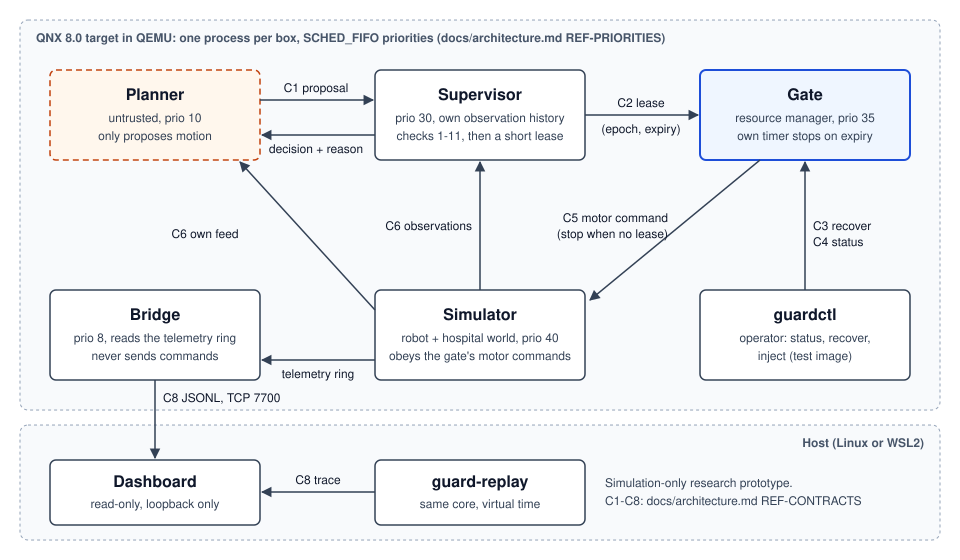

# GUARD — Gated Unexpired Authorization for Robotic Drives

**Stale decisions can't move the robot.**

GUARD is an independent runtime supervisor for a *simulated* autonomous mobile
robot on QNX 8.0. An untrusted planner (rule-based today, an LLM later) only
*proposes* motion. GUARD checks each proposal for provenance freshness, stopping
distance and restricted zones, then grants a short, epoch-fenced lease. A
separate gate process uses its own timer to stop the robot when the lease
expires, even if the supervisor has died.

Today the checks, lease rules and gate state machine run in a portable C++17
core under a deterministic host harness; the QNX processes that wire it to
message passing, timers and resource managers land with Stream B (planned
B2-B5) and run in QEMU, not on hardware.

Why QNX: the gate runs as an independent resource-manager process with its own
timer and message path, so the component that stops the robot does not share a
fate with the component that authorises it. In the design the supervisor, gate,
planner and simulator are separate processes; only the planner is treated as
untrusted.

> **Status:** in development for the QNX Global Hackathon 2026 (Robotics &
> Medical). Internal code freeze 10 Dec 2026, submission 15 Dec 2026.

## Demo

The 3-minute demo (host replay F3, dashboard, target `run-demo.sh` with
`guardctl`, and a refusal with its reason code) is specified in [demo/DEMO.md](demo/DEMO.md)
and recorded from `v1.0-rc1`. Video and GIF: planned (P4) - under 3:00, no QNX
logo, [storyboard and captions plan](docs/video/storyboard.md) in `docs/video/`.

## Limits — read first
<!-- gen:limits -->
<!-- claims-ok: negated -->
- No certified functional safety. GUARD claims no compliance with ISO 13849, IEC 61508, ISO 3691-4 or IEC 62304, and no SIL or PL rating.
- No real actuators, braking or vehicles. This is a simulation-only prototype.
- No hard real-time guarantee on hardware. QEMU timing is not hardware timing.
- No formal verification. Assurance comes from unit, scenario and property tests only.
- No defence against a compromised kernel, supervisor or gate. Only the planner is treated as untrusted.
- No QNX performance claims and no QNX-vs-Linux comparisons without BlackBerry's written approval.
<!-- gen:limits-end -->

<!-- gen:quickstart -->
## Quick start
### Host replay (Linux or WSL2)

```sh
python host/guard-replay --scenario scenarios/F0.yaml --seed 1000 --mode B2 --out out/F0.jsonl
```

### Dashboard (Linux or WSL2)

```sh
python dashboard/relay.py --trace out/runs/F3-B2-1003.jsonl
```

### On target (QNX SDP required, B's and P's machines only)

```sh
source ~/qnx800/qnxsdp-env.sh
image/run-demo.sh                 # user-mode networking, ssh on 127.0.0.1:2222, no sudo
image/run-demo.sh --net bridge    # br0, 10.10.10.2 (docs/setup.md Option B)
image/run-demo.sh --test          # adds guard-hog (fault F2)
image/run-demo.sh --stop
```
<!-- gen:quickstart-end -->

`bash tools/fresh_clone_demo.sh <ref>` replays the host part of this quick start
in a fresh clone and is what the nightly job runs.

<!-- gen:results -->
## Results

Source: host (Linux) harness, commit `4f1a18d`, 1 repeat(s) per scenario/config, [run 43876818251](https://github.com/Tauwho/GUARD/actions/runs/43876818251). Simulation only; no QNX numbers.

| Scenario | Runs | B2 gate mismatches | Baseline (B0/B1) mismatches | Ablation differences |
|---|---:|---:|---:|---:|
| F0 | 7 | 0 | 0 | 0 |
| F1 | 7 | 0 | 2 | 1 |
| F2 | 7 | 0 | 0 | 1 |
| F3 | 7 | 0 | 0 | 0 |
| F4 | 7 | 0 | 0 | 0 |
| F5 | 7 | 0 | 0 | 1 |
| F6 | 7 | 0 | 0 | 1 |
| F7 | 7 | 0 | 0 | 1 |
| F8 | 7 | 0 | 0 | 0 |

B2 mismatches are failures (CI gates them). Baseline mismatches are expected: B0/B1 remove the checks a scenario is meant to catch. Ablation differences are the hypothesis under test, reported even when the hypothesis is rejected.
<!-- gen:results-end -->

<!-- gen:evidence-map -->
## Evidence Map

| Evidence | Where it ran | Commit | Contracts | Bundle |
|---|---|---|---|---|
| image-layout | QNX 8.0 target (behaviour only) | `6913b85` | contracts-v1.1 | [20261116-6913b85-image-layout](evidence/20261116-6913b85-image-layout/manifest.json) |
| qnx-hog | QNX 8.0 target (behaviour only) | `3ed822e` | contracts-v1.1 | [20261116-3ed822e-qnx-hog](evidence/20261116-3ed822e-qnx-hog/manifest.json) |
| qnx-common-priv | QNX 8.0 target (behaviour only) | `f6dc640` | contracts-v1.1 | [20261116-f6dc640-qnx-common-priv](evidence/20261116-f6dc640-qnx-common-priv/manifest.json) |
| qnx-common-resmgr | QNX 8.0 target (behaviour only) | `0da47f6` | contracts-v1.1 | [20261116-0da47f6-qnx-common-resmgr](evidence/20261116-0da47f6-qnx-common-resmgr/manifest.json) |
| qnx-common-timer | QNX 8.0 target (behaviour only) | `667ec80` | contracts-v1.1 | [20261116-667ec80-qnx-common-timer](evidence/20261116-667ec80-qnx-common-timer/manifest.json) |
| qnx-common | QNX 8.0 target (behaviour only) | `7bdd68b` | contracts-v1.1 | [20261116-7bdd68b-qnx-common](evidence/20261116-7bdd68b-qnx-common/manifest.json) |
| setup-b | QNX 8.0 target (behaviour only) | `60aaa66` | contracts-v1.1 | [20261116-60aaa66-setup-b](evidence/20261116-60aaa66-setup-b/manifest.json) |
| setup-po | QNX 8.0 target (behaviour only) | `161b1e8` | - | [20261116-161b1e8-setup-po](evidence/20261116-161b1e8-setup-po/manifest.json) |
| core-on-target | QNX 8.0 target (behaviour only) | `161b1e8` | contracts-v1.0 | [20261116-161b1e8-core-on-target](evidence/20261116-161b1e8-core-on-target/manifest.json) |

Target bundles are transcripts, reason codes and test counts: behaviour, not
measurements. Numbers appear only in the host (Linux) Results section above.
<!-- gen:evidence-map-end -->

## How it works



The diagram shows the design in `docs/architecture.md`; the target processes land
with Stream B (scope items B2-B5).

1. The planner proposes a trajectory with a map version and a timestamp.
2. The supervisor rejects the proposal if the map is stale, the stopping
   distance exceeds the measured clearance, or the path enters a restricted
   zone. A rejection changes nothing and carries a reason code.
3. An accepted proposal gets a lease: an id, an epoch and a deadline.
4. The gate admits motion only under the current epoch and stops when the lease
   expires. A stale lease from a previous supervisor cannot be reused.
5. Every decision is a C8 telemetry record; the dashboard replays them
   read-only, and evidence bundles keep the transcripts.

Scenarios F0-F8 inject faults (stale map, planner stall, supervisor death,
replaced supervisor, restricted-zone entry) and compare outcomes against
hypotheses. See `docs/architecture.md` and the ADRs in `docs/adr/`.

## Repository map
| Path | Purpose |
|---|---|
| `contracts/` | Frozen interface contract (`contracts-v1.2`) and schemas |
| `core/` | Portable C++17 logic. No QNX calls |
| `qnx/` | QNX adapters. No business logic |
| `host/` | Deterministic host replay harness |
| `scenarios/` | Acceptance scenarios F0-F8 |
| `eval/` | Host evaluation matrix and report |
| `dashboard/` | Read-only telemetry viewer |
| `image/` | `mkqnximage` scripts. No images are committed |
| `evidence/` | Target and host evidence bundles |
| `docs/` | Architecture, decisions, limits, setup |
| `demo/`, `docs/video/` | Demo script, storyboard and captions |

## How we work
- [AGENTS.md](AGENTS.md): rules for humans and AI agents
- [CONTRIBUTING.md](CONTRIBUTING.md)
- [DECISIONS.md](DECISIONS.md): the decision log
- [docs/architecture.md](docs/architecture.md)
- [docs/limits.md](docs/limits.md)

## AI-assistance disclosure
Three people build this project with AI coding assistants. Assistants wrote
code, tests, checks and docs, and opened and merged pull requests. After the
initial bootstrap commit, every change reached `main` through a pull request
merged by its author once the required CI checks passed. Pull requests have no
required human review; a fresh-context agent self-review takes its place (D12,
D26). The humans set the rules and own the design decisions in `DECISIONS.md`. No
result in this README was generated by a model unprompted: the numbers come from
the Linux host harness, and target bundles are transcripts of runs on our own
machines.

## Licence
MIT. The QNX SDP is not included or redistributed. Each developer installs it
under their own non-commercial licence; CI never touches QNX.
