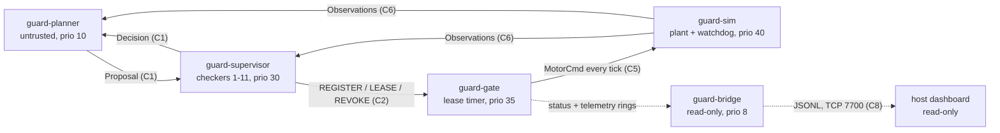

<!-- managed-by: guard-bootstrap v1 -->
# GUARD - Gated Unexpired Authorization for Robotic Drives

**Stale decisions can't move the robot.**

GUARD is a runtime supervisor for a *simulated* hospital delivery robot on QNX 8.0. An untrusted planner only proposes motion. GUARD checks each proposal against its own view of the world and grants a short, epoch-fenced lease. A separate gate process stops the robot with its own kernel timer when the lease runs out, even if the supervisor has died.

GUARD is a **simulation-only research prototype**. It is not a medical device and is not for real robots or patients.

> **Status:** draft README for the QNX Global Hackathon 2026 (Robotics & Medical). Sections marked `planned` or `TBD` are filled in from real runs before submission.


*GIF: `docs/media/demo.gif` -- planned (from the dashboard, #24).*

## The problem

An AI planner can be right about a world that no longer exists. A proposal can be sent just now but computed from an observation that is already old, from a map before a restricted zone switched on, or by a supervisor that was paused and replaced. A heartbeat only proves that the sender is alive. It does not prove that the decision being executed is still valid.

## How it works



1. The planner proposes a speed and turn rate, and says which observation it used.
2. The supervisor runs all 11 checkers against its **own** observation history: provenance and freshness, map version, sensor health, speed envelope, restricted zones and stopping distance.
3. If every check passes, the supervisor sends the gate a lease that expires after `T_lease` (default 250 ms). The gate accepts it only if the epoch and sequence number are current. The stopping-distance check counts the whole lease time as reaction time, so a shorter lease means a shorter required distance and allows more speed near hazards.
4. The gate sends a motor command every tick. When the lease expires, is revoked or comes from an old epoch, the gate brings the robot to a stop and, for some causes, latches until an operator recovers it.
5. If the gate itself dies, the simulated drive brakes after its own watchdog timeout.

Starving the planner path, for example with a busy process above the supervisor, can only let leases lapse, which stops the robot. It never extends motion.

Details: [docs/architecture.md](docs/architecture.md), contracts in [contracts/](contracts/), decisions in [DECISIONS.md](DECISIONS.md).

## QNX Evidence Map

Every row links to the code and to target evidence once it exists.

| Feature | Where in code | Evidence |
|---|---|---|
| `MsgSend` / `MsgReceive` / `MsgReply` | `qnx/common/src/ipc.cpp` (processes: `qnx/supervisor`, `qnx/planner`, planned) | library on target: [bundle](evidence/20261116-7bdd68b-qnx-common/) |
| Pulses + `timer_create` | `qnx/common/src/timer.cpp` (process: `qnx/gate`, planned) | library on target: [bundle](evidence/20261116-667ec80-qnx-common-timer/) |
| `TimerTimeout` on every blocking call | `qnx/common/src/ipc.cpp` | library on target: [bundle](evidence/20261116-7bdd68b-qnx-common/) |
| Resource manager `/dev/guard/*` | `qnx/common/src/resmgr.cpp` (process: `qnx/gate`, planned) | library on target: [bundle](evidence/20261116-0da47f6-qnx-common-resmgr/) |
| Resource manager `/dev/sim/*` with delayed reply | `qnx/common/src/resmgr.cpp` (process: `qnx/sim`, planned) | library on target: [bundle](evidence/20261116-0da47f6-qnx-common-resmgr/) |
| Priority map + priority inheritance (ADR-0006) | `qnx/common/src/sched.cpp` | planned (#45) |
| Process isolation | target transcript | planned (#45) |
| Client credential authorization | `qnx/common/src/priv.cpp` (`require_euid`) | library on target: [bundle](evidence/20261116-f6dc640-qnx-common-priv/) |
| `procmgr_ability` lock | `qnx/common/src/priv.cpp` (`drop_and_lock`) | library on target: [bundle](evidence/20261116-f6dc640-qnx-common-priv/) |
| `slog2` logging | `qnx/common/log` | planned (#45) |
| Shared-memory telemetry rings | `qnx/common/ring` | planned (#45) |
| `mkqnximage` image | `image/` | image layout on target: [bundle](evidence/20261116-6913b85-image-layout/) (GUARD processes not in the image yet) |
| Portable core tests run on the QNX target | `core/tests`, `cmake/qnx-x86_64.cmake` | [evidence/20261116-161b1e8-core-on-target](evidence/20261116-161b1e8-core-on-target/) |

## Quick start

Commands marked `planned` work once the linked issues land; the others run on `main` today.

**Host-only path** (no QNX needed; deterministic replay):

```sh
git clone https://github.com/Tauwho/GUARD.git && cd GUARD
cmake --preset host-debug && cmake --build --preset host-debug && ctest --preset host-debug
./build/host/guard-replay scenarios/F3.yaml --mode B2       # planned (#22)
python dashboard/relay.py --replay run.jsonl                # planned (#24)
```

**QNX path** (your own QNX SDP 8.0 licence and the quick-start target image in QEMU, x86_64):

```sh
source ~/qnx800/qnxsdp-env.sh                               # your own SDP install
cmake --preset qnx-x86_64 && cmake --build --preset qnx-x86_64   # core tests for the target (#31)
image/run-demo.sh                 # user-mode networking, ssh on 127.0.0.1:2222, no sudo
image/run-demo.sh --test          # adds guard-hog (fault F2)
image/run-demo.sh --stop
```

The image boots with the GUARD processes skipped until #38-#42 land ([image/README.md](image/README.md), #43).

Setup steps: [docs/setup.md](docs/setup.md).

## Results (functional only)

Numbers below come only from the **host (Linux) harness**. Runs on the QNX target are shown as behaviour (logs, reason codes and video), not as numbers.

| Scenario | Fault | B0 passthrough | B1 heartbeat | B2 GUARD |
|---|---|---|---|---|
| F0 | None (nominal delivery) | TBD (#23) | TBD (#23) | TBD (#23) |
| F1 | Stale planner | TBD (#23) | TBD (#23) | TBD (#23) |
| F2 | Delayed authorization | TBD (#23) | TBD (#23) | TBD (#23) |
| F3 | Supervisor killed | TBD (#23) | TBD (#23) | TBD (#23) |
| F4 | Sensor dropout | TBD (#23) | TBD (#23) | TBD (#23) |
| F5 | Insufficient stopping distance | TBD (#23) | TBD (#23) | TBD (#23) |
| F6 | Path through restricted zone | TBD (#23) | TBD (#23) | TBD (#23) |
| F7 | Zombie supervisor | TBD (#23) | TBD (#23) | TBD (#23) |
| F8 | Planner flood | TBD (#23) | TBD (#23) | TBD (#23) |

Each cell will show violation episodes and the final state, from the eval report (#23).

## Limits — read first
<!-- claims-ok: negated -->
- No certified functional safety. GUARD claims no compliance with ISO 13849, IEC 61508, ISO 3691-4 or IEC 62304, and no SIL or PL rating.
- No real actuators, braking or vehicles. This is a simulation-only prototype.
- No hard real-time guarantee on hardware. QEMU timing is not hardware timing.
- No formal verification. Assurance comes from unit, scenario and property tests only.
- No defence against a compromised kernel, supervisor or gate. Only the planner is treated as untrusted.
- No QNX performance claims and no QNX-vs-Linux comparisons without BlackBerry's written approval.

## AI-use disclosure

Three people build this project with AI coding assistants. Assistants drafted documents, contracts and code under human direction. A human team member merges every change once CI is green, and PRs written with an assistant tick the "AI-assisted" box. The rule-based planner is the baseline; an LLM route advisor is an optional extra (P1).

## Team

- [@dngvmnh](https://github.com/dngvmnh) -- product owner
- [@phatdat220707](https://github.com/phatdat220707) -- portable core and host tooling
- [@baofrovn](https://github.com/baofrovn) -- QNX target and image

## How we work

- [AGENTS.md](AGENTS.md): rules for humans and AI agents
- [CONTRIBUTING.md](CONTRIBUTING.md)
- [DECISIONS.md](DECISIONS.md)

CI runs on the host only. QNX runs happen on our own machines, and their results are committed as text evidence bundles in `evidence/`.

## Licence

MIT. The QNX SDP is not included or redistributed. Each developer installs it under their own licence.
